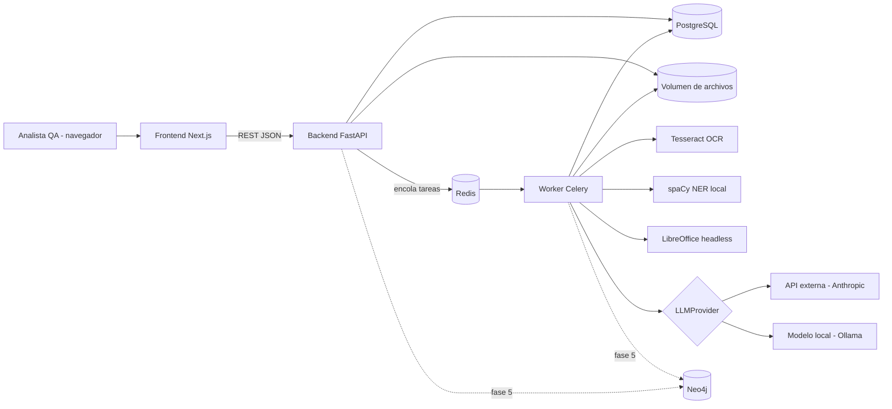

# Especificación Técnica — Copiloto de Certificación QA (Beyond Health)

Versión 2.1 — Documento de referencia para el desarrollo. Complementa a `CLAUDE.md`.
Si hay conflicto entre ambos, prevalecen las reglas de seguridad de `CLAUDE.md`.

**Cambios de la v2.1:** el flujo pasa a ser adaptable mediante *recetas*; los 10 pasos son el máximo, no el camino obligatorio. Se agregan: estilos de redacción de casos seleccionables, canal de ejecución por caso (UI, REST/JSON, SOAP/XML, archivo, batch, consulta DB), cinco clasificaciones de resultado (`passed`, `failed`, `inconclusive`, `blocked`, `new_defect`), sub-razones editables para `inconclusive`, marca `coverage_gap` en el caso, validación individual de candidato para cualquier origen de datos, biblioteca interna de certificaciones con anonimización local, seis tipos nuevos de fuente de contexto, controles de revisión C10–C14 y perfil de redacción del analista. La detección de nombres propios usa NER local (spaCy `es_core_news_md`) en PIIGuard y en la anonimización — nunca el LLM. `data_limitation` deja de ser clasificación de primer nivel; es sub-razón de `inconclusive`.

---

## 1. Visión

Herramienta web que acompaña al analista QA en la certificación de bugs y brechas de Beyond Health, de punta a punta. Entiende lo que se va a certificar, propone los casos de prueba, llena el formato CO-FR-VRA-03, redacta la solicitud de datos a fábrica, escoge los usuarios que sirven para cada caso, genera los requests REST/JSON o SOAP/XML, analiza las respuestas, redacta las evidencias y revisa todo antes de entregar.

**Principio rector:** el sistema propone y el analista decide. Los casos definitivos, los usuarios usados y la clasificación final de cada resultado son decisión del analista.

### 1.1 Flujo adaptable por receta

Cada certificación sigue la secuencia de etapas que define su **receta**. Las etapas posibles son las diez del flujo máximo; cada receta marca cada una como `required`, `optional` o `not_applicable`.

Etapas disponibles: `context` → `testcases` → `format` → `data_request` → `assignment` → `execution` → `analysis` → `documentation` → `review` → `closed`.

La configuración de la receta se copia a `certifications.active_stages` al crear la certificación; si la receta se edita después, las certificaciones en curso no cambian. El analista puede agregar o quitar etapas a mitad de la certificación; cada cambio genera un evento auditado.

### 1.2 Objetivos medibles

| Objetivo | Métrica |
|---|---|
| Reducir tiempo por certificación | Horas desde creación hasta entrega, por receta |
| Reducir tiempo de obtención de datos | Tiempo desde solicitud a fábrica hasta usuarios asignados |
| Acertar en la selección de datos | % de casos ejecutados con el primer usuario propuesto |
| Menos casos inconclusive | Casos clasificados `inconclusive` |
| Precisión de la propuesta de casos | % de casos propuestos que el analista conserva |
| Detectar ambigüedades antes de probar | Ambigüedades detectadas y resueltas |
| Reducir retrabajo | Certificaciones o casos devueltos |
| Entregas completas | Hallazgos de la revisión final antes de entregar |

### 1.3 Alcance

**Incluido (MVP, fases 0–4):** recetas y flujo adaptable, estilos de caso, fuentes de contexto extendidas, pasos 1–9 completos, generación de requests REST/JSON y SOAP/XML, validación individual de candidato, biblioteca de certificaciones, revisión C01–C14, entregables, métricas.

**Fases posteriores:** Mapa Vivo (Neo4j), tablero avanzado.

**Fuera de alcance:** conexión directa a Beyond Health, acceso a BD de fábrica, creación de ítems en TFS/Aranda.

### 1.4 Usuarios y roles

| Rol | Permisos |
|---|---|
| `analyst` | Crea y gestiona sus certificaciones, mapeos y plantillas personales |
| `lead` | Todo lo de analista + ver certificaciones y métricas de todo el equipo, gestionar recetas, catálogos y plantillas globales, editar `inconclusive_reasons` |
| `admin` | Gestión de usuarios y configuración del sistema |

---

## 2. Requerimientos funcionales

Cada requerimiento tiene un identificador `RF-XX` que debe citarse en commits y tests.

### 2.1 Certificaciones y recetas

- **RF-01** Crear una certificación con: tipo (`bug` | `brecha`), código externo, módulo, título y **receta**.
- **RF-01b** Una certificación avanza por las etapas definidas en `active_stages` (copia de la receta al momento de creación). Se puede volver a etapas anteriores sin perder lo hecho.
- **RF-01c** Gestionar recetas (CRUD). Cada receta define: modo de cada etapa (`required`/`optional`/`not_applicable`), estilo de caso, estilo de evidencia, canal de ejecución, origen de datos por defecto y patrón de casos sugerido. Las recetas `is_builtin = true` son de solo lectura para analistas.
- **RF-01d** El analista puede agregar o quitar etapas durante la certificación. Cada cambio se registra como `stage_added` / `stage_removed`.
- **RF-01e** Métricas segmentadas por receta; no comparar recetas diferentes.
- **RF-01f** Si una receta acumula frecuentes `stage_added` o `stage_removed`, señalarlo en las métricas como indicador de receta mal definida.
- **RF-03** Listar, filtrar y buscar certificaciones (tipo, módulo, receta, estado, fecha).
- **RF-04** Registrar inicio y fin de cada etapa activa. Las `optional` saltadas se registran con `status: skipped`. Las `not_applicable` no generan eventos.

### 2.2 Paso 1 — Entender el requerimiento

Fuentes de contexto (combinables; al menos una de las tres primeras):

| Tipo | Cuándo se usa |
|---|---|
| `requirement_document` (`.docx`, `.pdf`, `.doc`) | Insumo principal en brechas |
| `analyst_description` | Siempre disponible; insumo principal en bugs |
| `incident_report` | Habitual en bugs: caso Aranda, diagnóstico, changeset |
| `source_code` | **Opcional y excepcional.** Pasa por escáner de secretos antes del LLM |
| `unit_test` (CO-FR-VRA-02 `.docx`) | Prueba unitaria del desarrollador; ver RF-10b |
| `tfs_history` (texto pegado) | Historial del ítem en TFS; ver RF-10c |
| `assignment_email` | Correo con instrucciones de ejecución; ver RF-10d |
| `client_inconsistencies` | Lista de inconsistencias del cliente; ver RF-10e |
| `certification_model` | Certificación anterior como modelo de estilo; ver RF-10f |
| `doc_legacy` (`.doc` binario) | Documentos `.doc` antiguos; ver RF-10g |

- **RF-10** Registrar el contexto con cualquier combinación de fuentes.
- **RF-11** Descripción guiada por tipo (bug: qué sucedía, causa, corrección, qué probar; brecha: qué cambia, qué probar). Solo "qué se va a probar" es obligatorio.
- **RF-12** Extraer texto por secciones del documento, conservando títulos y numeración de pasos.
- **RF-13** Generar un **resumen en lenguaje de negocio** (máximo un párrafo) de lo que se certifica.
- **RF-14** Extraer **reglas** del contexto: operación, qué debe devolver, en qué condiciones y fuente.
- **RF-15** Detectar ambigüedades (§6.3) y contexto incompleto.
- **RF-16** Si hay código, usarlo para afinar reglas; pasa por escáner de secretos antes del LLM.
- **RF-10b** Fuente `unit_test`: extraer imágenes incrustadas del `.docx` y mostrarlas al analista con zoom. OCR local (Tesseract) bajo demanda para extraer texto. **Las imágenes y el texto OCR nunca se envían al LLM.** Del texto del documento se extrae: qué se ejecutó y qué resultado se mostró.
- **RF-10c** Fuente `tfs_history`: parsear entradas por fecha + autor; separar entradas de QA de entradas de fábrica; detectar changesets y hallazgos. Si hay más de un hallazgo en el ítem, preguntar al analista cuál se certifica; el resto se guarda como contexto adicional. El historial pasa por PIIGuard (regex + NER) antes del LLM.
- **RF-10d** Fuente `assignment_email`: extraer instrucciones de ejecución (rutas, carpetas, convenciones de nombre, orden de pasos) y generar un checklist con pasos y espacios para pantallazos.
- **RF-10e** Fuente `client_inconsistencies`: parsear la lista; cruzar cada punto con el texto del documento de requerimiento (si existe); agrupar por posible causa raíz (LLM + PIIGuard con NER).
- **RF-10f** Fuente `certification_model`: el analista sube un CO-FR-VRA-03 anterior o enlaza una entrada de la biblioteca; el sistema extrae el estilo de casos y de evidencias y los aplica como defaults. No se copian casos verbatim.
- **RF-10g** Fuente `doc_legacy`: convertir el `.doc` con LibreOffice headless antes de procesarlo.

### 2.3 Paso 2 — Proponer los casos de prueba

- **RF-20** Generar propuesta de casos con el estilo elegido para la certificación (§6.4). Código CP1, CP2…
- **RF-20b** Cinco estilos de redacción de caso como datos (`case_styles`), seleccionables por certificación y sobreescribibles por caso (§6.4).
- **RF-20c** Marca `coverage_gap` en el caso (no clasificación de resultado): `coverage_gap (bool)`, `coverage_gap_detail`, `coverage_gap_source (analyst|system)`, `coverage_gap_resolution (title_adjusted|case_added|documented|pending)`. Una resolución distinta de `pending` es obligatoria antes de entregar (C11). El control C11 compara título y descripción del caso con los textos de evidencia, usando el LLM con textos pasados por PIIGuard, y sugiere la marca automáticamente.
- **RF-21** Cada caso queda ligado a la regla que prueba y, si aplica, a una variante de datos.
- **RF-22** En bugs con un solo escenario se propone **un solo caso**. Sin regresión ni frontera extra salvo que el analista los pida.
- **RF-23** En brechas, las variantes adicionales se marcan `suggestion: true` y no entran por defecto.
- **RF-24** Reenfocar el objetivo de un caso: el LLM reescribe el caso y propone nueva variante; se guarda revisión en `test_case_revisions`.
- **RF-25** Importar casos (texto o Excel). Al importar, el sistema detecta el estilo del texto y sugiere el coincidente.
- **RF-26** Revisión de redacción en línea (§6.4), adaptada al estilo seleccionado. Son avisos, no bloqueos.
- **RF-27** Aprobar los casos definitivos.

### 2.4 Paso 3 — Llenar el formato CO-FR-VRA-03

- **RF-30** Llenar automáticamente los campos deducibles: ID del requerimiento, nombre del cambio, cliente, aplicativo, módulo y descripción.
- **RF-31** Pedir al analista los campos no deducibles: proyecto, fechas, tipo de cambio y responsable. Proponer como sugerencia el último valor usado.
- **RF-32** Cada campo indica su origen (`deducido` / `analista`) y si está confirmado.
- **RF-33** Campos configurables sin código (`templates/co-fr-vra-03/fields.yaml`).

### 2.5 Paso 4 — Solicitar los datos a fábrica

*Este paso es `required` en `service_soap_xml` y `required` cuando `data_origin = factory_request`; `optional` en `brecha_date_rule` y con orígenes `colleague_request`/`report_search`; `not_applicable` para el resto.*

- **RF-40** Agrupar los casos aprobados por variante de datos.
- **RF-40b** Declarar el **origen de datos** al crear la certificación (default desde la receta): `colleague_request`, `report_search`, `developer_case`, `client_file`, `manual_search`, `created_records`, `factory_request`.
- **RF-40c** Pasos 4 y 5 condicionados por el origen: `not_applicable` para todos salvo `factory_request`; `optional` para `colleague_request` y `report_search`. En `service_rest_json` con `factory_request`, los pasos 4 y 5 se activan automáticamente como `required`.
- **RF-40d** **Avisos previos a la ejecución** (independientes del origen): si el sistema detecta en los metadatos de la asignación, o el analista lo declara, cualquiera de estas condiciones, se muestra una advertencia que debe marcarse como revisada antes de ejecutar:
  - "Este registro puede haber sido corregido manualmente en BD"
  - "La fecha de validación cae fuera de la vigencia de la afiliación"
  - "El registro creado puede no haber quedado como se esperaba"
- **RF-41** Por cada variante, redactar en **lenguaje natural, sin SQL**: condición y cantidad por rol.
- **RF-42** Incluir la lista de campos requeridos del afiliado (del catálogo). El analista puede agregar o quitar campos.
- **RF-43** Generar el texto completo listo para copiar.
- **RF-44** Al agregar un campo nuevo, ofrecer guardarlo en el catálogo para próximas certificaciones del mismo servicio.

### 2.6 Paso 5 — Recibir el archivo y asignar usuarios

*Condicionado por `data_origin` y receta. La validación individual (RF-50b) está disponible siempre.*

- **RF-50** Cargar el archivo de fábrica en `.xlsx`, `.xls`, `.csv` o `.txt`.
- **RF-50b** **Validación individual de candidato** (disponible para cualquier `data_origin`, incluido `manual_search`): el analista ingresa los datos de un usuario específico (vigencia y, si el servicio los tiene, sus registros hijos/tramos), y el sistema evalúa las reglas de riesgo activas del servicio, calcula la fecha de validación según la estrategia de la variante y explica si el usuario es apto. Determinístico y local; no requiere cargar el archivo de fábrica.
- **RF-51** Mapear columnas a campos del catálogo. El mapeo se guarda por huella de encabezado.
- **RF-52** Si la variante o el analista indica que el archivo trae varias filas por afiliado, agrupar por clave configurada antes de filtrar. Por defecto: una fila por afiliado.
- **RF-53** Filtrar candidatos que cumplen la condición de su variante, de forma local y determinística (pandas).
- **RF-54** Aplicar **reglas de riesgo** activas del servicio (§6.7): descartan o penalizan usuarios. Reglas generales por defecto: K05, K06. Reglas adicionales sembrables por servicio (K01–K04 para `servicio_regimen`).
- **RF-55** Proponer, por caso, un usuario y la fecha de validación, más hasta 2 suplentes.
- **RF-56** Explicar en lenguaje natural por qué el usuario sirve (condiciones cumplidas, riesgos revisados, fecha propuesta).
- **RF-57** Mostrar usuarios descartados con el motivo.
- **RF-58** Variante sin candidatos → solicitud complementaria.
- **RF-59** Reemplazar manualmente el usuario o la fecha.

### 2.7 Paso 6 — Ejecutar

- **RF-60** Gestionar **plantillas de request** por servicio y canal (`soap_xml` o `rest_json`): el analista pega un request de ejemplo y marca qué valores son variables. Para `soap_xml`: importación opcional desde WSDL o proyecto SoapUI. Para `rest_json`: detección de variables en el JSON de ejemplo.
- **RF-60b** Canal de ejecución por caso (`execution_channel`): `ui`, `rest_json`, `soap_xml`, `file_upload`, `batch`, `db_query`. Default desde la receta; sobreescribible por caso. Solo `rest_json` y `soap_xml` generan request.
- **RF-60c** Para canal `ui`: generar un **checklist de ejecución** (pasos y espacios para pantallazos), precompletado desde el `assignment_email` si está disponible.
- **RF-60d** Para canal `file_upload`: mostrar la convención de nombre del archivo y espacio para confirmar la carga.
- **RF-60e** Al entrar a la etapa `execution`: preguntar *"¿El changeset [N] ya está desplegado en el ambiente?"*. Sin confirmación, la etapa no avanza.
- **RF-60f** Registrar `channel_switched` si el analista cambia el canal durante la ejecución.
- **RF-61** Generar el request de cada caso llenando la plantilla con el usuario y la fecha asignados.
- **RF-62** Exportar todos los requests como proyecto SoapUI (`.xml`) con un test case por CP.
- **RF-63** El sistema no guarda endpoints con credenciales ni ejecuta los servicios.
- **RF-64** Subir pantallazos por caso y validarlos con OCR: deben mostrar hora y URL (§6.10).

### 2.8 Paso 7 — Analizar el resultado

*Este paso es `required` en recetas con canal `soap_xml` o `rest_json`. `optional` para las demás.*

- **RF-70** Recibir la respuesta del servicio (pegar XML o JSON, o subir archivo).
- **RF-70b** **Clasificaciones** de resultado (§6.12): `passed`, `failed`, `inconclusive`, `blocked`, `new_defect`.
- **RF-70c** Para casos de servicio: el analista puede pegar la lista de validaciones que mostró el sistema y marcar cuáles pertenecen a la regla certificada vs. "ruido de otras validaciones". La observación se redacta solo con las marcadas como pertinentes.
- **RF-71** Comparar de forma determinística los valores de la respuesta con el resultado esperado. Para `soap_xml`: XPath. Para `rest_json`: JSONPath (§6.12). Comparación local, sin LLM.
- **RF-72** Clasificar el caso según los criterios de §6.12.
- **RF-73** Proponer la observación en el estilo de Sonda (LLM con resultado de la comparación, sin datos del afiliado ni la respuesta completa).
- **RF-73b** Clasificación `new_defect`: no requiere la referencia TFS/Aranda al clasificar; se exige antes de entregar (C12). Al marcar `new_defect`, el sistema ofrece generar un `factory_message` pre-rellenado con la descripción del hallazgo.
- **RF-74** Si `inconclusive`, ofrecer reasignar un suplente o generar solicitud complementaria.

### 2.9 Paso 8 — Documentar

- **RF-80** Generar por caso los textos de evidencia: condición, consulta, resultado y observaciones.
- **RF-81** Generar el CO-FR-VRA-03 llenando la plantilla base. El formato nunca se altera (§6.11).
- **RF-82** Generar nota TFS y correo. El prompt del LLM se restringe a 1–2 oraciones, sin negritas, sin explicar la corrección.
- **RF-82b** Registrar ediciones sobre textos generados en `writing_edits`. Los textos se almacenan **ya anonimizados** (PIIGuard + NER spaCy) y se purgan con RNF-06.
- **RF-82c** Construir un **perfil de redacción** por analista a partir de sus ediciones: longitud media, presencia de negritas, verbos preferidos. Visible y editable en Configuración.
- **RF-82d** Aplicar el perfil como instrucciones adicionales al LLM al generar nuevos textos.
- **RF-83** Todos los textos son editables. Descargar un `.zip` con entregables y evidencias.
- **RF-83b** Entregables opcionales por certificación: `aranda_response` (respuesta al cliente), `factory_message` (mensaje a fábrica con hallazgo o ajuste de datos), `decision_diagram` (diagrama subido o generado).

### 2.10 Paso 9 — Revisar

- **RF-90** Ejecutar el control final antes de permitir la entrega (§6.13). Controles C01–C14.
- **RF-91** Severidad: `error` bloquea la entrega, `warning` no.
- **RF-92** El analista puede aceptar un `warning` con un comentario.

### 2.11 Biblioteca de certificaciones

- **RF-120** Al cerrar una certificación, ofrecer publicarla en la biblioteca interna (opt-in). El sistema muestra la vista previa anonimizada con los reemplazos resaltados; el analista puede corregir un reemplazo, excluir campos o no publicar.
- **RF-121** **Proceso de anonimización** (ejecutado **antes** de la purga de RNF-06):
  1. Reemplazar todos los valores de las bases cargadas y de las asignaciones con marcadores `[CC_1]`, `[CONTRATO_1]`, `[AFILIADO_1]` (mismo valor → mismo marcador dentro de la cert).
  2. PIIGuard (regex: documentos, correos, teléfonos) como segunda capa.
  3. **NER local spaCy `es_core_news_md`**: detectar y enmascarar nombres propios de personas no presentes en las bases. Ningún nombre va al LLM para detección.
  4. Eliminar fechas de nacimiento. Conservar fechas operativas (vigencias, tramos, fecha de validación, radicación).
  5. No se guardan en la biblioteca: pantallazos, imágenes, archivos de fábrica, respuestas de servicios ni texto OCR.
  6. **Test obligatorio** `test_library_no_pii`: ningún valor de las bases aparece en la entrada de la biblioteca.
- **RF-122** Cada entrada guarda: módulo, receta, patrón de casos, estilo de caso y de evidencia, canal, origen de datos, casos anonimizados, textos de evidencia anonimizados, clasificaciones, nota TFS anonimizada, correo anonimizado, problemas encontrados, analista autor (metadato, no visible para otros por defecto).
- **RF-123** Al crear una nueva certificación, buscar en la biblioteca por módulo + texto completo (PostgreSQL `tsquery`). Proponer hasta 3 entradas similares.
- **RF-124** El analista puede importar una entrada de la biblioteca o subir un CO-FR-VRA-03 anterior como modelo (equivalente a la fuente `certification_model`).

### 2.12 Métricas

- **RF-100** Eventos y contadores por etapa, por receta: casos propuestos vs. conservados, usuarios reemplazados, casos `inconclusive`, hallazgos de revisión, rechazos OCR, devoluciones, eventos `stage_added`/`stage_removed` por receta.
- **RF-101** Registrar manualmente una devolución.
- **RF-102** Registrar certificaciones de línea base con su duración y receta.
- **RF-103** Tablero con comparación contra línea base por receta y exportación a Excel.

### 2.13 Mapa Vivo — fase 5

- **RF-110** Al cerrar, registrar en el grafo: módulo, receta, reglas, variantes, reglas de riesgo, casos y resultados.
- **RF-111** Consultar en lenguaje natural.
- **RF-112** Sugerir variantes, campos y reglas para nuevas certificaciones del mismo servicio.
- **RF-113** Glosario de términos del dominio.

---

## 3. Requerimientos no funcionales

- **RNF-01 Privacidad:** los datos de afiliados (archivo de fábrica, respuestas de servicios, pantallazos, imágenes incrustadas, texto OCR) nunca salen de la VM ni se envían a un LLM. Todo texto que va al LLM pasa obligatoriamente por PIIGuard (regex + NER spaCy). Verificado por tests.
- **RNF-02 Portabilidad:** todo corre con `docker compose up` en una VM Linux.
- **RNF-03 Proveedor de IA intercambiable:** cambiar entre API externa y modelo local solo con variables de entorno.
- **RNF-04 Rendimiento:** filtrado y asignación sobre archivos de hasta 50.000 filas en menos de 5 s. Operaciones LLM, OCR, NER y LibreOffice son asíncronas con indicador de progreso.
- **RNF-05 Trazabilidad:** registro de auditoría de acciones relevantes.
- **RNF-06 Retención:** bases de usuarios, respuestas de servicios, evidencias y registros en `writing_edits` se eliminan automáticamente N días después de cerrar la certificación (configurable, por defecto 30 días).
- **RNF-07 Idioma:** interfaz y documentos generados en español; código en inglés.
- **RNF-08 Calidad de código:** tipado estricto, linters y cobertura mínima de 80 % en lógica de dominio.

---

## 4. Arquitectura

### 4.1 Vista general



### 4.2 Estilo

Monolito modular. Cada módulo tiene sus propias capas y solo se comunica con otros a través de sus servicios públicos.

```
<modulo>/
  router.py
  schemas.py
  models.py
  service.py
  repository.py
  tasks.py
  domain/
```

### 4.3 Componentes

| Componente | Responsabilidad |
|---|---|
| Frontend | Interfaz por etapas activas (según receta), tablero de métricas |
| Backend API | Autenticación, CRUD, orquestación, encolado de tareas |
| Worker | Extracción de documentos, llamadas LLM, OCR, NER, LibreOffice, generación de requests y entregables |
| spaCy NER | Detección local de nombres propios. No usa el LLM. |
| LibreOffice headless | Conversión de `.doc` binario a texto extraíble |
| PostgreSQL | Datos transaccionales, métricas, auditoría, índice full-text de la biblioteca |
| Redis | Broker Celery y caché |
| Volumen de archivos | Documentos, bases, respuestas, evidencias y entregables |
| Neo4j (fase 5) | Mapa Vivo |
| Ollama (opcional) | Modelo local si la política no permite API externa |

---

## 5. Stack tecnológico

### 5.1 Backend

| Tecnología | Uso |
|---|---|
| Python 3.12 | Lenguaje |
| FastAPI | API REST |
| Pydantic v2 + pydantic-settings | Validación y configuración |
| SQLAlchemy 2 (async) + asyncpg | ORM |
| Alembic | Migraciones |
| Celery 5 + Redis 7 | Tareas asíncronas |
| python-docx, pdfplumber | Lectura de documentos |
| pandas, openpyxl, xlrd | Bases y plantilla Excel |
| scipy | Asignación óptima (`linear_sum_assignment`) |
| lxml | Plantillas SOAP/XML y XPath |
| jsonpath-ng | JSONPath para análisis de respuestas REST/JSON |
| zeep (opcional) | Lectura de WSDL |
| holidays | Festivos de Colombia para días hábiles |
| pytesseract + Pillow + OpenCV | OCR y preprocesamiento de imágenes |
| spaCy 3 + `es_core_news_md` | NER local: detección de nombres propios en PIIGuard y anonimización |
| Jinja2 | Plantillas de texto |
| anthropic, httpx | Proveedores LLM |
| argon2-cffi, PyJWT | Contraseñas y tokens |
| structlog | Logging estructurado |
| neo4j (driver) | Fase 5 |

### 5.2 Frontend

| Tecnología | Uso |
|---|---|
| Node 22 + Next.js 15 (App Router) + TypeScript | Aplicación |
| Tailwind CSS + shadcn/ui | Estilos y componentes |
| TanStack Query | Estado del servidor |
| React Hook Form + Zod | Formularios y validación |
| TanStack Table | Tablas |
| Recharts | Gráficas de métricas |
| openapi-typescript | Tipos generados desde OpenAPI |

### 5.3 Infraestructura y calidad

| Tecnología | Uso |
|---|---|
| Docker + Docker Compose | Despliegue en VM |
| Caddy | Proxy inverso y HTTPS |
| ruff, mypy (strict) | Lint y tipado backend |
| ESLint, Prettier | Lint frontend |
| pytest, pytest-asyncio, httpx, factory-boy | Tests backend |
| Vitest, Playwright | Tests frontend y end-to-end |
| pre-commit | Hooks locales |
| gitleaks | Evitar secretos en commits |

---

## 6. Diseño detallado

### 6.1 Estructura del repositorio

```
copiloto-certificacion/
  CLAUDE.md
  docs/
    SPEC.md
    adr/
  backend/
    app/
      main.py
      core/                  # config, db, security, logging, storage, audit
      llm/                   # provider.py, pii_guard.py, secrets_scanner.py, prompts/
      users/
      certifications/
      recipes/               # recetas, estilos de caso, patrones de caso
      library/               # biblioteca de certificaciones
      context/               # paso 1: fuentes, resumen, reglas, ambigüedades
      testcases/             # paso 2: propuesta, reenfoque, estilo, coverage_gap
      certformat/            # paso 3: campos del CO-FR-VRA-03
      datarequest/           # paso 4: variantes, catálogo de campos, solicitud
      testdata/              # paso 5: carga, mapeo, riesgos, asignación, validación individual
      requests/              # paso 6: plantillas y generación REST/JSON + SOAP/XML
      evidence/              # paso 6: pantallazos, OCR, imágenes incrustadas
      analysis/              # paso 7: comparación XPath/JSONPath y clasificación
      deliverables/          # paso 8: textos, formato, nota TFS, correo
      review/                # paso 9: controles C01–C14
      metrics/
      knowledge/             # fase 5
    alembic/
    tests/
      unit/
      integration/
      fixtures/              # SOLO datos sintéticos
    pyproject.toml
    Dockerfile
  frontend/
    src/app/
    src/components/
    src/lib/api/
    Dockerfile
  templates/
    co-fr-vra-03/
    data_request.md.j2
    tfs_note.md.j2
    email.md.j2
    aranda_response.md.j2
    factory_message.md.j2
  infra/
    docker-compose.yml
    docker-compose.dev.yml
    Caddyfile
  scripts/
  .env.example
  .gitignore
  .pre-commit-config.yaml
```

### 6.2 Capa LLM, PIIGuard y NER

**LLMProvider (sin cambios):**

```python
class LLMProvider(Protocol):
    async def complete(self, system: str, messages: list[Message], *, max_tokens: int) -> str: ...
    async def structured(self, system: str, messages: list[Message], schema: type[BaseModel]) -> BaseModel: ...
```

- Implementaciones: `AnthropicProvider`, `OllamaProvider`, `FakeProvider` (tests con respuestas fijas).
- Selección por `LLM_PROVIDER=anthropic|ollama|fake`.
- `structured()` pide JSON, valida con Pydantic y reintenta hasta 2 veces.
- Prompts versionados en `llm/prompts/` (ej. `extract_rules.v1.md`).

**PIIGuard (ampliado con NER):**

Antes de enviar cualquier texto al LLM, `PIIGuard.check()` aplica dos capas en orden:

1. **Regex:** números de documento colombiano (6–10 dígitos), correos electrónicos, teléfonos.
2. **NER local (spaCy `es_core_news_md`):** entidades `PER` (nombres propios de personas). Los detectados se enmascaran como `[PERSONA_1]`, `[PERSONA_2]`, etc.

**La detección de nombres propios ocurre localmente; los nombres nunca llegan al LLM.**

Los documentos de requerimiento pueden traer ejemplos con datos reales: se enmascaran (`[DOC_1]`, `[CONTRATO_1]`, `[PERSONA_1]`) y se registra la advertencia. Los valores enmascarados se restituyen localmente en la respuesta si hace falta.

Aplica a: historial de TFS, inconsistencias del cliente, textos de evidencia, `writing_edits` y cualquier texto antes de enviarse al LLM o guardarse en la biblioteca.

**Escáner de secretos:** el código fuente opcional pasa por `SecretsScanner` antes del LLM (contraseñas inline, connection strings, tokens, llaves privadas).

### 6.3 Reglas y detector de ambigüedades (paso 1)

**Estructura de una regla:**

```json
{
  "code": "R1",
  "operation": "Consulta de régimen del afiliado (servicio REST/JSON)",
  "returns": "El régimen vigente en la fecha consultada",
  "conditions": "Cuando el afiliado tiene varios tramos de régimen, se toma el tramo cuya vigencia contiene la fecha de consulta",
  "source": {"kind": "requirement_document", "section": "3.2"},
  "from_code": false
}
```

**Detector de ambigüedades**, enfoque híbrido:

1. **Reglas locales:** comparadores sin frontera ("mayor", "menor", "hasta", "a partir de"), unidades sin calificador ("días" sin "hábiles"/"calendario"), términos vagos.
2. **LLM (con PIIGuard):** ramas faltantes, contradicciones, condiciones sin resultado definido, criterios de desempate no definidos.

Tipos: `boundary_undefined`, `implicit_unit`, `missing_branch`, `contradiction`, `vague_term`, `undefined_result`, `undefined_tiebreak`, `incomplete_context`.

### 6.4 Recetas, estilos de caso y patrones de diseño

**Recetas** (`recipes`): configuración de la certificación como datos. Al crear una certificación se copia en `active_stages`.

Recetas iniciales (`is_builtin = true`):

| Código | Nombre | Etapas required | Etapas optional | Patrón | Estilo | Canal | Origen |
|---|---|---|---|---|---|---|---|
| `bug_simple` | Bug — un caso | context, testcases, format, execution, documentation, review | — | `one_case` | `short` | `ui` | `developer_case` |
| `bug_before_after` | Bug — antes/después | context, testcases, format, execution, documentation, review | — | `before_after` | `short` | `ui` | `developer_case` |
| `bug_negative_control` | Bug — negativo + control | context, testcases, format, execution, documentation, review | — | `negative_control` | `short` | `ui` | `colleague_request` |
| `brecha_date_rule` | Brecha con regla de fecha | context, testcases, format, execution, documentation, review | data_request, assignment | `boundary` | `validate_that` | `ui` | `colleague_request` |
| `service_soap_xml` | Servicio SOAP/XML | context, testcases, format, data_request, assignment, execution, analysis, documentation, review | — | `matrix_by_role` | `consult_service` | `soap_xml` | `factory_request` |
| `service_rest_json` | Servicio REST/JSON | context, testcases, format, execution, analysis, documentation, review | data_request, assignment | `matrix_by_role` | `consult_service` | `rest_json` | `manual_search` |
| `file_batch` | Cargue de archivo o batch | context, testcases, format, execution, documentation, review | — | `one_case` | `action_validations` | `file_upload` | `client_file` |
| `client_cases` | Casos del cliente | context, testcases, format, execution, documentation, review | — | `client_cases` | `validate_that` | `ui` | `client_file` |

Nota sobre `service_rest_json`: cuando el analista cambia `data_origin` a `factory_request`, las etapas `data_request` y `assignment` pasan automáticamente de `optional` a `required`.

**Estilos de caso** (`case_styles`):

| Código | Nombre | Estructura |
|---|---|---|
| `short` | Formato corto | Título + Descripción + Resultado esperado |
| `validate_that` | Validar que… | `"Validar que [sistema] [acción] cuando [condición]. Resultado esperado: …"` |
| `action_validations` | Al [acción]… | `"Al [acción], se ejecutan las siguientes validaciones: – [lista]. Resultado esperado: …"` |
| `consult_service` | Consultar un… | `"Consultar un [titular/beneficiario] por [tipo], donde [condición]. Resultado esperado: …"` |
| `full_sheet` | Hoja completa | Objetivo, Precondiciones, Datos de entrada, Actividades y Pasos |

El estilo se hereda de la receta y se puede sobreescribir por caso. El linter S01–S06 adapta sus reglas al estilo: `action_validations` admite múltiples ítems en el resultado; `full_sheet` requiere precondiciones; `short` aplica todas las reglas de forma estricta.

**Patrones de diseño de casos** (`case_patterns`):

| Patrón | Descripción | Certificaciones de referencia (anonimizadas) |
|---|---|---|
| `one_case` | Un único caso | Bug tipo cargue PILA, bug tipo archivo R1 |
| `before_after` | Estado antes y estado después | Bug semanas de cotización |
| `negative_control` | Reproduce el bug + control de lo válido | Bug fecha inicio IPS |
| `boundary` | Antes / igual / después del límite | Exclusión de beneficiario |
| `threshold_control_oos` | Límite + control + fuera de alcance | Brecha incapacidad retroactiva |
| `by_scenario` | Un caso por escenario de negocio | Bug titular sin régimen |
| `matrix_by_role` | N roles × M condiciones | Brecha 990 (6 titular + 6 beneficiario) |
| `client_cases` | Importar plan existente del cliente | Brecha movilidad subsidiado |
| `logic_monitoring` | Lógica de negocio + monitoreo/log | Cargue histórico subsidiados |

La receta `file_batch` sugiere `one_case` por defecto. `logic_monitoring` está disponible como patrón alternativo si el analista lo agrega.

**Revisión de redacción** (`testcases/domain/style.py`):

| Código | Regla | Adaptación por estilo |
|---|---|---|
| S01 | Título corto y específico (≤ 120 caracteres) | `full_sheet`: sin límite estricto |
| S02 | Descripción de máximo 2 oraciones | `action_validations`: admite lista de ítems |
| S03 | Sin palabras vagas (correctamente, adecuadamente…) | Todos |
| S04 | Un solo resultado esperado observable | `action_validations`: admite varios resultados en lista |
| S05 | Términos consistentes con el glosario y entre casos | Todos |
| S06 | Toda regla tiene al menos un caso aprobado (aviso de certificación) | Todos |

### 6.5 Catálogo de campos y mapeo de columnas

El catálogo (`field_catalogs`) define, por módulo o servicio, qué campos se le piden a fábrica. Campos iniciales (módulo piloto, Novedades de afiliación): `document_type`, `document_number`, `role`, `contract_number`, `affiliation_start_date`, `affiliation_end_date`, `affiliation_status`, más los campos específicos del servicio a certificar.

Cada campo tiene: clave, etiqueta en español, tipo de dato y sinónimos para el mapeo.

**Mapeo de columnas:**
1. Calcular la huella del encabezado (hash de nombres normalizados).
2. Si existe mapeo guardado con esa huella, proponer directamente.
3. Si no, proponer por similitud de nombres y sinónimos; si hay dudas, con el LLM enviando **solo nombres de columna y tipo detectado, nunca valores**.
4. El analista confirma y se guarda.

### 6.6 DSL de condiciones y variante de datos

**Variante de datos:** condición que debe cumplir el usuario de prueba. Tiene una versión en palabras y una estructurada:

```json
{
  "code": "V1",
  "description_nl": "Beneficiario activo con contrato vigente y sin fecha fin de contrato",
  "quantity": {"titular": 0, "beneficiario": 2},
  "conditions": [
    {"field": "role", "op": "eq", "value": "beneficiario"},
    {"field": "affiliation_status", "op": "eq", "value": "activo"},
    {"field": "contract_end_date", "op": "is_null"}
  ],
  "validation_date": {"strategy": "offset", "base": "ips_start_date", "offset": -1, "unit": "calendar_days"},
  "mutates_state": true
}
```

- Operadores: `eq`, `ne`, `in`, `not_in`, `gt`, `gte`, `lt`, `lte`, `between`, `is_null`, `not_null`, `contains`, comparación entre campos (`other_field`).
- Estrategias de fecha de validación: `offset` (días calendario, hábiles con festivos colombianos, o meses desde un campo base), `fixed` (valor literal), `derived` (expresión calculada localmente).
- El LLM traduce la variante en palabras a la versión estructurada; el analista la confirma. El DSL se evalúa con pandas en `testdata/domain/filter.py`, sin `eval` ni código generado.
- Si el archivo trae varias filas por afiliado, se indica en `grouping_note` (texto); el `loader.py` agrupa antes de filtrar.

### 6.7 Reglas de riesgo, validación individual y asignación masiva

**Reglas de riesgo** (`risk_rules`): configurables por servicio.

| Código | Riesgo | Efecto | Sembrada para |
|---|---|---|---|
| K01 | Tramo anulado o cerrado cuya vigencia efectiva —calculada usando la fecha de cierre cuando es posterior a la fecha fin declarada— se cruza con la fecha de validación | `exclude` | `servicio_regimen` |
| K02 | Dos o más tramos válidos con la misma fecha de inicio (empate) | `exclude` | `servicio_regimen` |
| K03 | Tramos cuyo identificador de afiliación pertenece a otro contrato | `exclude` | `servicio_regimen` |
| K04 | Fecha de validación fuera de `[affiliation_start_date, affiliation_end_date]` | `exclude` | `servicio_regimen` |
| K05 | Datos incompletos en campos que usa la condición | `exclude` | todos (regla general) |
| K06 | El afiliado se usó en otra certificación reciente | `penalize` | todos (regla general) |

K01–K04 están implementadas y se siembran como activas **únicamente** para el servicio `servicio_regimen`. Para otros servicios, el analista puede activarlas desde la interfaz si aplican. Reglas adicionales se definen por servicio como combinación del DSL, sin código.

**Validación individual de candidato (RF-50b):** disponible para cualquier `data_origin` (incluido `manual_search`, como en la brecha 990). El analista registra en la interfaz:
- Vigencia del afiliado: fechas de inicio/fin, rol, estado.
- Registros hijos (si el servicio los tiene): lista de tramos con los campos del catálogo.

El sistema aplica las reglas de riesgo activas del servicio, calcula la fecha de validación según la estrategia de la variante, y devuelve: apto / no apto + motivo en lenguaje natural + fecha propuesta. Determinístico y local.

**Asignación masiva (RF-53–RF-58):** activada cuando `data_origin = factory_request` o el analista activa las etapas opcionales. Algoritmo:
1. Para cada caso: candidatos = filas que cumplen la variante (filtro pandas) y no tienen riesgo `exclude`.
2. Para cada candidato: calcular fecha de validación. Sin fecha válida → descartar con motivo.
3. Matriz de costo casos × candidatos: suma de penalizaciones + criterios de desempate configurables. Candidato inválido = costo infinito.
4. Un usuario distinto por caso por defecto (configurable si `mutates_state = false`).
5. Resolver con `scipy.optimize.linear_sum_assignment`. Suplentes: los 2 de menor costo siguiente.
6. Variante sin solución → solicitud complementaria (RF-58).
7. Determinístico: misma entrada, misma salida.

**Explicación (RF-56):** se arma localmente con plantillas a partir de condiciones cumplidas y riesgos revisados. Sin LLM.

### 6.8 Solicitud de datos a fábrica

Plantilla Jinja2 (`templates/data_request.md.j2`). El LLM puede pulir la redacción sin cambiar condiciones, cantidades ni campos (se valida).

Estructura:
1. Saludo y referencia al bug o brecha.
2. Por variante: condición en palabras y cantidad por rol.
3. Campos requeridos del afiliado por nombre legible.
4. Formato esperado: Excel o CSV con encabezados. Si el servicio requiere varias filas por afiliado, indicarlo en palabras junto con la clave de agrupación.

### 6.9 Plantillas y generación de requests (paso 6)

El módulo `requests/` maneja dos formatos:

**SOAP/XML (`soap_xml`):**
- Plantilla: XML de ejemplo, lista de variables con XPath y fuente (campo del afiliado, fecha de validación, valor fijo).
- Creación: el analista pega un request de SoapUI; el sistema detecta candidatos a variables (documentos, fechas, tipos) y el analista confirma. Importación opcional desde WSDL o proyecto SoapUI.
- Generación: `lxml`, preservando namespaces. Validación XML bien formado; si hay WSDL, contra el esquema.
- Exportación a proyecto SoapUI (`.xml`) con un test case por CP.

**REST/JSON (`rest_json`):**
- Plantilla: JSON de ejemplo, lista de variables con JSONPath y fuente.
- Creación: el analista pega el JSON de ejemplo; el sistema detecta strings que parecen documentos (6–10 dígitos), fechas (ISO 8601) y tipos de documento.
- Generación: sustitución de variables por JSONPath (librería `jsonpath-ng`). Validación JSON bien formado.
- Sin WSDL. La exportación a SoapUI incluye test cases REST.
- **Ejemplo basado en brecha 990:** variable `scope` (régimen) y `date` con formato `"AAAA-MM-DDT00:00:00"` al final del body; ambos son detectables por el sistema.

Las plantillas no guardan credenciales, tokens ni endpoints con contraseña.

### 6.10 Validación OCR de evidencias

1. Preprocesar imagen (escala de grises, contraste, binarización).
2. OCR con Tesseract (`spa+eng`).
3. Hora: regex `HH:MM` o `HH:MM:SS`, con o sin a.m./p.m., priorizando zona inferior derecha.
4. URL: regex `http(s)://` o dominio, priorizando franja superior.
5. Resultado: `valid`, `warning` o `rejected`. El analista puede aceptar un `warning` con justificación.
6. El texto OCR **no se envía al LLM**.

Para imágenes del `unit_test`: el mismo pipeline OCR se aplica bajo demanda del analista.

### 6.11 Plantilla CO-FR-VRA-03

- La plantilla oficial vacía se carga como plantilla global (no se versiona si contiene información interna).
- `fields.yaml` define campos de encabezado, origen y celda:

```yaml
fields:
  requirement_id:   {source: deduced, sheet: "Pruebas", cell: "C5"}
  change_name:      {source: deduced, sheet: "Pruebas", cell: "C6"}
  client:           {source: deduced, sheet: "Pruebas", cell: "C7"}
  application:      {source: deduced, sheet: "Pruebas", cell: "C8"}
  module:           {source: deduced, sheet: "Pruebas", cell: "C9"}
  description:      {source: deduced, sheet: "Pruebas", cell: "C10"}
  project:          {source: analyst, sheet: "Pruebas", cell: "F5"}
  start_date:       {source: analyst, sheet: "Pruebas", cell: "F6", format: "dd/mm/yyyy"}
  end_date:         {source: analyst, sheet: "Pruebas", cell: "F7", format: "dd/mm/yyyy"}
  change_type:      {source: analyst, sheet: "Pruebas", cell: "F8"}
  responsible:      {source: analyst, sheet: "Pruebas", cell: "F9"}
tables:
  test_cases:
    sheet: "Pruebas"
    start_row: 14
    columns: {code: "A", title: "B", description: "C", expected_result: "D", result: "E", observation: "F"}
evidence:
  sheet: "Evidencias"
  block: [condition, query, result, observations, screenshots]
```

Solo se escriben valores; se preservan estilos, fórmulas y celdas combinadas.

### 6.12 Análisis de la respuesta

**Para SOAP/XML:** XPath con `lxml`. Aserciones en la plantilla: XPath de la respuesta → expresión del valor esperado. Detección de SOAP Faults.

**Para REST/JSON:** JSONPath con `jsonpath-ng`. Misma estructura de aserciones. Detección de errores HTTP (4xx, 5xx). El parser detecta automáticamente si la respuesta es XML o JSON.

**Resultado esperado calculado:** a partir de la regla y del usuario asignado, el sistema calcula localmente los valores esperados. Todo determinístico, sin LLM.

**Clasificaciones:**

| Clasificación | Descripción |
|---|---|
| `passed` | Todas las aserciones coinciden, o el analista confirma el comportamiento correcto (canales sin análisis automático). |
| `failed` | Alguna aserción no coincide y los datos del usuario eran válidos para el caso. |
| `inconclusive` | La evidencia no prueba el escenario. **Requiere sub-razón** de la tabla `inconclusive_reasons`. |
| `blocked` | No se pudo ejecutar el caso (ambiente, acceso, proceso fallido). Se conserva del v1.1. |
| `new_defect` | Se encontró un bug distinto al certificado. La referencia TFS/Aranda se exige antes de entregar (C12), no al clasificar. |

`data_limitation` **no es clasificación de primer nivel en v2.1**. Los casos que antes se clasificarían así usan `inconclusive` con la sub-razón correspondiente.

**Sub-razones de `inconclusive`** (tabla `inconclusive_reasons`, editable por rol `lead`):

| Código | Etiqueta |
|---|---|
| `data_condition_not_met` | El dato no cumplía realmente la condición de la variante |
| `date_out_of_validity` | La fecha de validación cae fuera de la vigencia del afiliado |
| `data_already_corrected` | El registro ya había sido corregido manualmente en BD |
| `other_validation_noise` | El resultado se debe a otra validación del sistema (ruido) |
| `other` | Otro motivo (documentar en observación) |

**`coverage_gap` (marca en el caso, RF-20c):** C11 ejecuta un LLM con título y descripción del caso comparados contra los textos de evidencia, ambos pasados por PIIGuard. Si detecta discrepancia, sugiere `coverage_gap = true` con `coverage_gap_detail`. El analista confirma o rechaza. Si `coverage_gap = true`, la resolución no puede quedar en `pending` al entregar.

**Observación:** el LLM redacta recibiendo solo el resultado de la comparación (campo, match/no-match, códigos no personales), nunca la respuesta completa ni datos del afiliado.

### 6.13 Revisión final

Controles en `review/domain/checks.py`:

| Código | Control | Severidad |
|---|---|---|
| C01 | Caso `passed` sin observación | warning |
| C02 | Campo del formato vacío | error |
| C03 | Fechas con formato distinto a `dd/mm/yyyy` o fechas incoherentes (fin antes de inicio) | error |
| C04 | Códigos de caso no consecutivos o duplicados | warning |
| C05 | Nombre del requerimiento o código distinto entre formato, casos, nota TFS y correo | error |
| C06 | Caso sin pantallazo o con evidencia rechazada por OCR | error |
| C07 | Caso sin clasificación final | error |
| C08 | Caso `inconclusive` sin sub-razón seleccionada | warning |
| C09 | Texto de evidencia vacío (condición, consulta, resultado u observaciones) | error |
| C10 | En el Excel: módulo distinto al de la certificación activa, **o** se detectan en las celdas del formato códigos de otros bugs o brechas distintos al de esta certificación | error |
| C11 | `coverage_gap = true` con `coverage_gap_resolution = pending` | error |
| C12 | Caso clasificado `new_defect` sin referencia TFS/Aranda registrada | error |
| C13 | Módulo o descripción del formato no corresponden al hallazgo certificado (match de texto simple) | warning |
| C14 | Inconsistencia entre casos de la misma certificación: bloques de evidencia con estructura distinta, o diferencia de más de N pantallazos entre el caso con más y el con menos capturas (N configurable, por defecto 3) | warning |

### 6.14 Nota TFS y correo

Plantillas Jinja2 (`tfs_note.md.j2`, `email.md.j2`). Prompt del LLM restringido: máximo 2 oraciones, sin negritas, sin explicar cómo se corrigió, sin agregar datos no presentes en la certificación. Los textos generados se guardan en `writing_edits` ya anonimizados (PIIGuard + NER spaCy).

---

## 7. Modelo de datos

Todas las tablas tienen `id` (UUID), `created_at`, `updated_at`.

| Tabla | Campos principales |
|---|---|
| `users` | email, full_name, password_hash, role, is_active, writing_profile (JSONB) |
| `recipes` | code, name, description, stages (JSONB: `{stage: {mode: required|optional|not_applicable}}`), default_case_style, default_evidence_style, default_execution_channel, default_data_origin, suggested_case_pattern, is_builtin, owner_id |
| `case_styles` | code, name, fields (JSONB), template_jinja, lint_rules (JSONB), example |
| `case_patterns` | code, name, description, n_cases_typical, notes |
| `inconclusive_reasons` | code, label, description, is_active |
| `certifications` | owner_id, type, external_code, module, service, title, recipe_code (FK), active_stages (JSONB), case_style, evidence_style, execution_channel, data_origin, business_summary, stage, status, closed_at |
| `stage_events` | certification_id, stage, started_at, ended_at, status (executed/skipped), source (recipe/added/removed) |
| `context_sources` | certification_id, kind (requirement_document/analyst_description/incident_report/source_code/unit_test/tfs_history/assignment_email/client_inconsistencies/certification_model/doc_legacy), content (JSONB), file_path, extracted_text, sections (JSONB) |
| `tfs_findings` | source_id (FK→context_sources), finding_index, date, author, author_role (qa/fabrica), changeset, text, selected (bool) |
| `rules` | certification_id, code, operation, returns, conditions, source (JSONB), from_code |
| `ambiguities` | certification_id, type, fragment, location, explanation, question, resolution, resolved_by, resolved_at |
| `test_cases` | certification_id, code, title, description, expected_result, rule_id, variant_id, execution_channel, case_style, status (draft/approved/discarded), suggestion, style_findings (JSONB), coverage_gap, coverage_gap_detail, coverage_gap_source (analyst/system), coverage_gap_resolution (title_adjusted/case_added/documented/pending), order |
| `test_case_revisions` | test_case_id, previous (JSONB), reason (edit/refocus), created_by |
| `format_fields` | certification_id, key, value, source (deduced/analyst), confirmed |
| `analyst_defaults` | user_id, key, value |
| `data_variants` | certification_id, code, description_nl, quantity (JSONB), conditions (JSONB), validation_date (JSONB), mutates_state, confirmed, grouping_note |
| `data_requests` | certification_id, kind (initial/complementary), text, fields (JSONB), sent_at |
| `field_catalogs` | module, service, key, label, data_type, synonyms (JSONB) |
| `user_bases` | certification_id, data_request_id, file_path, header_fingerprint, row_count, affiliate_count, mapping_id, purge_after |
| `column_mappings` | owner_id, header_fingerprint, mapping (JSONB), service, is_global |
| `risk_rules` | service, code, description, definition (JSONB), effect (exclude/penalize), weight, is_active |
| `assignments` | test_case_id, user_base_id, affiliate_ref, rank (0=principal, 1–2 suplentes), validation_date, derived_values (JSONB), cost, explanation, manual_override |
| `discarded_candidates` | certification_id, variant_id, affiliate_ref, reasons (JSONB) |
| `execution_checklists` | test_case_id, steps (JSONB), channel_used, channel_original |
| `request_templates` | service, operation, format (soap_xml/rest_json), sample_body, variables (JSONB), assertions (JSONB), owner_id, is_global |
| `request_instances` | test_case_id, template_id, body, generated_at |
| `response_instances` | test_case_id, file_path, extracted (JSONB), comparison (JSONB), uploaded_at |
| `executions` | test_case_id, proposed_result, final_result (passed/failed/inconclusive/blocked/new_defect), inconclusive_reason (FK→inconclusive_reasons), new_defect_ref, noise_validations (JSONB), certified_validations (JSONB), observation, confirmed_by, executed_at |
| `evidences` | test_case_id, file_path, ocr_status, ocr_time_found, ocr_url_found, accepted_with_reason |
| `evidence_texts` | test_case_id, condition, query, result, observations |
| `review_findings` | certification_id, code, severity, message, target (JSONB), accepted, comment |
| `deliverables` | certification_id, kind (co_fr_vra_03/tfs_note/email/aranda_response/factory_message/decision_diagram/zip), file_path, content, generated_at |
| `templates` | kind, name, file_path, config (JSONB), is_global, owner_id |
| `cert_library` | source_cert_id, module, recipe_code, case_count, cases_anon (JSONB), evidence_style, data_origin, channel, classifications (JSONB), tfs_note_anon, email_anon, problems (JSONB), author_id, published_at, tsv (tsvector para búsqueda FTS) |
| `writing_edits` | user_id, cert_id, text_type (tfs_note/email/evidence_text/observation), original_anon, edited_anon, created_at, purge_after |
| `rework_events` | certification_id, test_case_id, reason, reported_at |
| `baseline_certifications` | owner_id, type, module, recipe_code, duration_minutes, date, notes |
| `llm_calls` | module, prompt_name, prompt_version, provider, tokens_in, tokens_out, duration_ms, success |
| `audit_log` | user_id, action, entity, entity_id, metadata (JSONB) |

Notas:
- `affiliate_ref` es la clave de agrupación del afiliado dentro del archivo; los datos personales se leen del archivo cuando se necesitan y no se duplican en tablas.
- Las respuestas de servicios se guardan como archivo (pueden traer datos personales) y se purgan con RNF-06.
- `writing_edits.original_anon` y `writing_edits.edited_anon` contienen texto ya anonimizado (PIIGuard + NER). Se purgan con RNF-06.
- `cert_library`: la anonimización se ejecuta antes de la purga de RNF-06 de los archivos fuente.

---

## 8. API REST

Prefijo `/api/v1`. Autenticación con JWT en cookie httpOnly. OpenAPI en `/api/docs` solo en desarrollo. Las operaciones con LLM, OCR, NER o generación de archivos son tareas asíncronas consultables en `GET /tasks/{task_id}`.

| Método y ruta | Descripción |
|---|---|
| `POST /auth/login`, `POST /auth/logout`, `GET /auth/me` | Sesión |
| `GET/POST /certifications`, `GET/PATCH /certifications/{id}` | CRUD |
| `POST /certifications/{id}/stage` | Cambiar etapa |
| `POST /certifications/{id}/stages/add`, `DELETE /certifications/{id}/stages/{stage}` | Agregar / quitar etapa |
| `GET/POST /recipes`, `PATCH /recipes/{id}` | Gestión de recetas |
| `GET /case-styles`, `GET /case-patterns` | Catálogos de estilos y patrones |
| `GET /inconclusive-reasons`, `PATCH /inconclusive-reasons/{code}` | Sub-razones (solo lead) |
| **Paso 1** | |
| `GET /certifications/{id}/context` | Fuentes del contexto |
| `POST /certifications/{id}/context/document` | Subir documento (req_doc, unit_test, doc_legacy) |
| `PUT /certifications/{id}/context/description` | Descripción guiada o libre |
| `PUT /certifications/{id}/context/incident-report` | Reporte del incidente |
| `PUT /certifications/{id}/context/code` | Código fuente (opcional) |
| `PUT /certifications/{id}/context/tfs-history` | Historial TFS (texto) |
| `PUT /certifications/{id}/context/assignment-email` | Correo de asignación |
| `PUT /certifications/{id}/context/client-inconsistencies` | Lista de inconsistencias |
| `POST /certifications/{id}/context/certification-model` | Subir cert modelo o enlazar biblioteca |
| `DELETE /context-sources/{id}` | Quitar fuente |
| `GET /certifications/{id}/tfs-findings`, `PATCH /tfs-findings/{id}` | Hallazgos TFS y selección del que se certifica |
| `POST /certifications/{id}/context/analyze` | Resumen, reglas y ambigüedades (tarea) |
| `GET/PATCH /certifications/{id}/rules` | Reglas |
| `GET /certifications/{id}/ambiguities`, `PATCH /ambiguities/{id}` | Ambigüedades |
| **Paso 2** | |
| `POST /certifications/{id}/testcases/generate` | Proponer casos (tarea) |
| `POST /certifications/{id}/testcases/import` | Importar casos |
| `GET/POST /certifications/{id}/testcases`, `PATCH/DELETE /testcases/{id}` | CRUD |
| `POST /testcases/{id}/refocus` | Reenfocar objetivo (tarea) |
| `PATCH /testcases/{id}/coverage-gap` | Marcar / desmarcar coverage_gap |
| `POST /certifications/{id}/testcases/approve` | Aprobar definitivos |
| **Paso 3** | |
| `GET/PUT /certifications/{id}/format-fields` | Campos del formato |
| **Paso 4** | |
| `GET/PUT /certifications/{id}/variants` | Variantes |
| `POST /certifications/{id}/data-requests` | Generar solicitud |
| `GET/PATCH /data-requests/{id}` | Ver y editar |
| `GET/POST /field-catalogs` | Catálogo de campos |
| **Paso 5** | |
| `POST /certifications/{id}/userbase` | Subir archivo de fábrica |
| `GET /userbases/{id}/preview` | Vista previa |
| `POST /userbases/{id}/mapping/suggest`, `PUT /userbases/{id}/mapping` | Mapeo |
| `POST /certifications/{id}/assign` | Asignación masiva |
| `GET /certifications/{id}/assignments`, `PATCH /assignments/{id}` | Ver y reemplazar |
| `GET /certifications/{id}/discarded` | Descartados con motivo |
| `POST /certifications/{id}/validate-candidate` | **Validación individual de candidato** (RF-50b) |
| `GET/POST /risk-rules`, `PATCH /risk-rules/{id}` | Reglas de riesgo |
| **Paso 6** | |
| `GET/POST /request-templates`, `PATCH /request-templates/{id}` | Plantillas de request |
| `POST /request-templates/detect-variables` | Detectar variables en ejemplo |
| `POST /certifications/{id}/requests/generate` | Generar requests |
| `GET /certifications/{id}/requests/export` | Exportar proyecto SoapUI |
| `POST /testcases/{id}/evidence`, `PATCH /evidence/{id}` | Pantallazos y OCR |
| `GET /certifications/{id}/execution/checklist` | Checklist para canal UI |
| **Paso 7** | |
| `POST /testcases/{id}/response` | Subir respuesta (dispara análisis) |
| `PUT /testcases/{id}/execution` | Confirmar clasificación y observación |
| **Paso 8** | |
| `POST /certifications/{id}/evidence-texts/generate`, `PATCH /evidence-texts/{id}` | Textos de evidencia |
| `POST /certifications/{id}/deliverables/generate` | Formato, nota TFS, correo y zip (tarea) |
| `GET /certifications/{id}/deliverables`, `GET /deliverables/{id}/download` | Ver y descargar |
| **Paso 9** | |
| `POST /certifications/{id}/review` | Ejecutar revisión |
| `GET /certifications/{id}/review`, `PATCH /review-findings/{id}` | Ver y aceptar hallazgos |
| **Biblioteca** | |
| `POST /certifications/{id}/library/publish` | Publicar en biblioteca (tarea de anonimización) |
| `GET /library/search` | Buscar en biblioteca |
| `GET /library/{id}` | Ver entrada |
| **Otros** | |
| `GET /tasks/{task_id}` | Estado de tarea asíncrona |
| `GET /metrics/summary`, `GET /metrics/export`, `POST /metrics/baseline`, `POST /metrics/rework` | Métricas |
| `GET/POST /templates` | Plantillas de texto |

Errores con formato uniforme: `{"error": {"code": "...", "message": "...", "details": {...}}}`.

---

## 9. Seguridad

- **Autenticación:** Argon2id; JWT de corta duración (30 min) con refresh; cookies `httpOnly`, `Secure`, `SameSite=Strict`.
- **Autorización:** por rol y por propietario en cada endpoint.
- **Archivos:** validar extensión y tipo MIME real; límite configurable (20 MB); nombres aleatorios en disco; nunca servir por ruta directa.
- **Privacidad de datos de afiliados:**
  - Nunca se envían al LLM. Garantizado por `PIIGuard` (regex + **NER spaCy local**) y por diseño: filtrado, asignación, OCR y comparación de respuestas son locales y determinísticos.
  - **La detección de nombres propios usa spaCy NER localmente. Los nombres nunca van al LLM para ser detectados.**
  - Test obligatorio `test_no_pii_reaches_llm`: ejecuta el flujo completo con `FakeProvider` espía y falla si algún valor del archivo de fábrica, respuestas de servicios, imágenes o texto OCR aparece en lo enviado.
  - Test obligatorio `test_library_no_pii`: ningún valor de las bases aparece en la entrada de la biblioteca.
  - Purga automática: RNF-06 (Celery beat diario). Incluye `writing_edits`.
- **Secretos:** solo en `.env`; `gitleaks` en pre-commit. Las plantillas de request no guardan credenciales.
- **Cabeceras:** CSP, `X-Content-Type-Options`, `X-Frame-Options` vía Caddy.
- **Auditoría:** `audit_log` registra subidas, aprobaciones, exportaciones, publicaciones en biblioteca, purgas.
- **Dependencias:** `pip-audit` y `npm audit` en CI.

---

## 10. Interfaz

| Ruta | Pantalla |
|---|---|
| `/login` | Inicio de sesión |
| `/` | Tablero: certificaciones activas, recientes, métricas rápidas por receta |
| `/certifications/new` | Crear certificación: selector de receta con descripción y ejemplo de etapas activas |
| `/certifications/[id]` | Asistente con barra de progreso mostrando solo etapas activas; botón "Agregar etapa" |
| └ 1. Entender | Pestañas por tipo de fuente; galería de imágenes para `unit_test`; hallazgos TFS con selector del que se certifica; resumen, reglas, ambigüedades |
| └ 2. Casos | Tabla editable con estilo de caso activo; avisos S01–S06 adaptados al estilo; marcas `coverage_gap` con resolución; botón reenfocar; importar |
| └ 3. Formato | Campos deducidos y campos del analista |
| └ 4. Solicitud | Variantes y texto de solicitud generado |
| └ 5. Asignación | Carga del archivo, mapeo, propuesta por caso; validación individual siempre disponible |
| └ 6. Ejecución | Request por caso (REST o SOAP según canal) con botón copiar; checklist para UI; confirmación de changeset; zona de pantallazos con estado OCR |
| └ 7. Análisis | Comparación esperado vs. obtenido (XPath/JSONPath); marcado de validaciones ruido vs. certificadas; clasificación, sub-razón e inconclusive_reason |
| └ 8. Documentación | Textos de evidencia; formato; nota TFS; correo; entregables opcionales |
| └ 9. Revisión | Hallazgos C01–C14 por severidad con enlace a la corrección; botón entregar (bloqueado si hay errores) |
| `/library` | Biblioteca: búsqueda, vista de entradas, publicar |
| `/metrics` | Tablero segmentado por receta con comparación contra línea base |
| `/settings` | Recetas, estilos de caso, catálogo de campos, reglas de riesgo, `inconclusive_reasons`, plantillas, mapeos, mi estilo de redacción |

Principios: todo en español; acciones largas con indicador de progreso; botón "copiar" en todo texto generado; lo propuesto se distingue visualmente de lo confirmado; nada se exporta sin revisión.

---

## 11. Estrategia de pruebas

| Nivel | Qué cubre | Herramienta |
|---|---|---|
| Unitario | Dominio de cada módulo: ambigüedades, estilos de caso S01–S06, DSL, reglas de riesgo K01–K06, fechas con festivos, asignación, OCR regex, XPath y JSONPath, clasificaciones y sub-razones, controles C01–C14, PIIGuard regex+NER, anonimizador de biblioteca | pytest |
| Integración | Endpoints con BD real (contenedor) y `FakeProvider` | pytest + httpx |
| Privacidad | `test_no_pii_reaches_llm`, `test_library_no_pii`, tests de PIIGuard con NER spaCy | pytest |
| Frontend | Componentes y formularios | Vitest |
| End-to-end | Dos fixtures completos: `bug_negative_control` y `service_rest_json` | Playwright |

**Fixtures sintéticos** (`scripts/generate_fixtures.py`):

*Fixture `bug_negative_control`:*
- Bug sin documento: descripción guiada + reporte con cédula ficticia (para verificar enmascaramiento).
- Dos casos: reproduce el bug (`failed`) + control (`passed`).
- Canal UI; receta `bug_negative_control`.
- Clasificación final: un caso `inconclusive` con sub-razón `data_already_corrected`.

*Fixture `service_rest_json` (basado en brecha 990, anonimizado):*
- Documento de brecha sintético: consulta de régimen de afiliado por fecha, servicio REST/JSON.
- 12 casos: 6 titular + 6 beneficiario; estilo `consult_service`.
- Usuarios con tramos que incluyen específicamente:
  - **CP4:** fecha de validación fuera del rango de vigencia de la afiliación → riesgo K04 activo → el sistema emite el aviso RF-40d y marca el caso antes de la ejecución.
  - **CP6:** afiliado con un único tramo; fecha de validación fuera del rango de ese tramo. El servicio devuelve el único tramo sin importar la fecha → resultado esperado `new_defect`. No es caso de control.
  - **CP10:** tramo cuya fecha de cierre es posterior a su fecha fin declarada, por lo que el tramo aparece vigente en la fecha consultada → riesgo K01 activo (vigencia efectiva calculada con fecha de cierre) → el sistema emite el aviso RF-40d y marca el caso antes de la ejecución.
  - **CP12:** fecha de validación anterior al inicio de la afiliación → riesgo K04 activo → el sistema emite el aviso RF-40d y marca el caso antes de la ejecución.
  - CP1–CP3, CP5, CP7–CP9, CP11: afiliados con tramos válidos según sus condiciones.
- Respuestas JSON sintéticas con el campo `scope` (régimen):
  - CP1 (titular, tramo único correcto): respuesta con `scope` coincidente → `passed`.
  - CP2 (beneficiario, dos tramos): respuesta con `scope` incorrecto → `failed`.
  - CP3 (titular, sin afiliación activa): error HTTP 400 → `blocked`.
  - CP6 (un solo tramo, fecha fuera): servicio devuelve el tramo → `new_defect`.
  - CP7 (beneficiario, tramo frontera): respuesta con datos distintos a lo esperado → `inconclusive` (sub-razón `data_condition_not_met`).
- Plantilla de request REST/JSON con variable `scope` y variable `date` en formato `"AAAA-MM-DDT00:00:00"`.
- Para CP4 y CP12: el analista marca el aviso como revisado antes de ejecutar.

*Fixture de biblioteca:*
- Versión anonimizada del fixture `service_rest_json` publicada en `cert_library`.
- Test `test_library_no_pii`: ningún valor de los usuarios del fixture aparece en la entrada de la biblioteca.

*Fixture de revisión final:*
- Certificación con errores sembrados: campo del formato vacío (C02), módulo distinto en el Excel (C10), código de bug anterior en el Excel (C10), `coverage_gap` sin resolver (C11), `new_defect` sin referencia (C12).

Cobertura mínima: 80 % en `domain/`, 60 % global.

---

## 12. Despliegue

- `infra/docker-compose.yml`: perfiles `libreoffice` (opcional, para `.doc` legacy) y `neo4j` (fase 5).
- Al iniciar el backend: `alembic upgrade head` + seed automático de recetas, estilos de caso, patrones, sub-razones de inconclusive y reglas de riesgo K01–K06 (K01–K04 asociadas a `servicio_regimen`, K05–K06 a `*`).
- Descarga automática del modelo spaCy `es_core_news_md` al iniciar si no está presente (script `scripts/download_models.py`).
- Script `scripts/backup.sh` para respaldo de PostgreSQL y archivos.

Variables de entorno adicionales en v2.1:

```
SPACY_MODEL=es_core_news_md
LIBREOFFICE_PATH=/usr/bin/soffice
LIBRARY_ANONYMIZE=true
RETENTION_DAYS=30
MAX_UPLOAD_MB=20
```

Requisitos mínimos: 4 vCPU, 8 GB RAM, 50 GB disco. Con modelo local Ollama: 16 GB RAM o más.

---

## 13. Fases y criterios de aceptación

Cada fase termina con: tests pasando, cobertura cumplida y `docker compose up` funcional.

### Fase 0 — Recetas, flujo adaptable y estilos

- Tablas `recipes`, `case_styles`, `case_patterns`, `inconclusive_reasons` con seed.
- Columnas `recipe_code`, `active_stages`, `case_style`, `evidence_style`, `execution_channel`, `data_origin` en `certifications`.
- Columnas `status`, `source` en `stage_events`.
- Módulo `recipes/`: CRUD + seed de 8 recetas, 5 estilos, 9 patrones, 5 sub-razones.
- `certifications/service.py`: `create_certification` copia `active_stages`; `add_stage`/`remove_stage` con eventos.
- Frontend: selector de receta en creación; barra de progreso solo con etapas activas; botón "Agregar etapa".
- **Aceptación:** crear cert `bug_simple` → solo 6 etapas (context, testcases, format, execution, documentation, review); crear `service_soap_xml` → las 10; agregar etapa y registrar evento `stage_added`; todos los tests existentes siguen pasando.

### Fase 1 — Contexto ampliado + Casos multi-estilo + Biblioteca

- PIIGuard ampliado con NER spaCy (`llm/pii_guard.py`).
- Fuentes nuevas: `tfs_history` (parser + detector de hallazgos), `unit_test` (extractor de imágenes + OCR bajo demanda), `assignment_email` (generador de checklist), `doc_legacy` (LibreOffice headless).
- `testcases/domain/style.py`: linter adaptado al estilo; detector de estilo al importar casos.
- Columna `case_style` en `test_cases`; campos `coverage_gap*`.
- Módulo `library/`: `anonymizer.py` (sustitución por marcadores + PIIGuard + NER spaCy), publicación opt-in con vista previa, búsqueda FTS.
- **Aceptación:** pegar historial TFS con 2 hallazgos → sistema pregunta cuál; subir CO-FR-VRA-02 con imagen → imagen visible, OCR disponible, texto no va al LLM; nombre propio en texto de prueba → enmascarado por NER sin llamar al LLM; cerrar cert → vista previa anonimizada con reemplazos resaltados; crear cert nueva del mismo módulo → sugerencia de la biblioteca; `test_library_no_pii` pasa.

### Fase 2 — Canales de ejecución + Resultados + Revisión

- Módulo `requests/` (renombrar `soap/`): REST/JSON templates con detección de variables JSON y comparación JSONPath.
- Columna `execution_channel` en `test_cases`; tabla `execution_checklists`.
- Tablas `request_templates`, `request_instances`, `response_instances` (renombrando `soap_*`).
- Clasificaciones extendidas: extender enum `executions.final_result`; columnas `inconclusive_reason`, `new_defect_ref`, `noise_validations`, `certified_validations`.
- `analysis/domain/response_parser.py`: branch JSON con JSONPath.
- `review/domain/checks.py`: C10 ampliado (códigos de otros bugs en Excel), C11–C14 nuevos.
- Pregunta de changeset (RF-60e); eventos `channel_switched`.
- **Aceptación:** generar request REST/JSON estilo brecha 990 → JSON válido con `scope` y `date`; clasificar `new_defect` → C12 activo hasta ingresar la referencia; C10 detecta código de bug distinto en el Excel; `test_no_pii_reaches_llm` pasa con respuesta JSON.

### Fase 3 — Datos (flujo factory + validación individual)

- RF-50b: endpoint `POST /certifications/{id}/validate-candidate`, servicio y evaluación local de K01–K06 según el servicio.
- Módulos `datarequest/` y `testdata/` completos: activos solo cuando `data_origin = factory_request` o el analista activa las etapas opcionales.
- Seed de K01–K04 para `servicio_regimen`, K05–K06 como generales.
- Avisos RF-40d integrados en `testdata/service.py`.
- Fixture end-to-end `service_rest_json` completo: 12 casos, CP4 y CP12 marcados con aviso antes de ejecutar.
- **Aceptación:** cert `bug_simple` → etapas 4 y 5 ausentes; cert `service_rest_json` con `manual_search` → RF-50b disponible; un usuario con K01 activo → explicación de exclusión; CP4 recibe aviso `date_out_of_validity` antes de ejecutar.

### Fase 4 — Perfil de redacción + Entregables opcionales

- Tabla `writing_edits` con anonimización antes de guardar (PIIGuard + NER) y purga RNF-06.
- `deliverables/domain/profile_builder.py`: analizar ediciones → extraer patrones → perfil JSONB en `users`.
- Aplicar perfil como instrucciones adicionales al LLM.
- Entregables opcionales: `aranda_response`, `factory_message`, `decision_diagram`.
- **Aceptación:** después de 5 certs con ediciones sistemáticamente más cortas y sin negritas, el perfil lo refleja y los nuevos textos son más cortos sin intervención manual.

### Fase 5 — Mapa Vivo (Neo4j)

- Nodos incluyen receta, canal, estilo y origen de datos como atributos.
- Al cerrar una certificación: registrar en el grafo. Al iniciar una nueva del mismo servicio: sugerir variantes, campos y reglas.
- **Aceptación:** dos certificaciones del mismo servicio cerradas → la tercera recibe sugerencias de variantes y reglas de riesgo.

### Fase 6 — Piloto de equipo y métricas avanzadas

- Permisos de líder; recetas, catálogos y reglas de riesgo globales editables.
- RF-103 completo: tablero por receta con comparación contra línea base y exportación a Excel.
- **Aceptación:** el líder ve todas las certificaciones del equipo; el tablero muestra tiempos promedio por receta.

---
